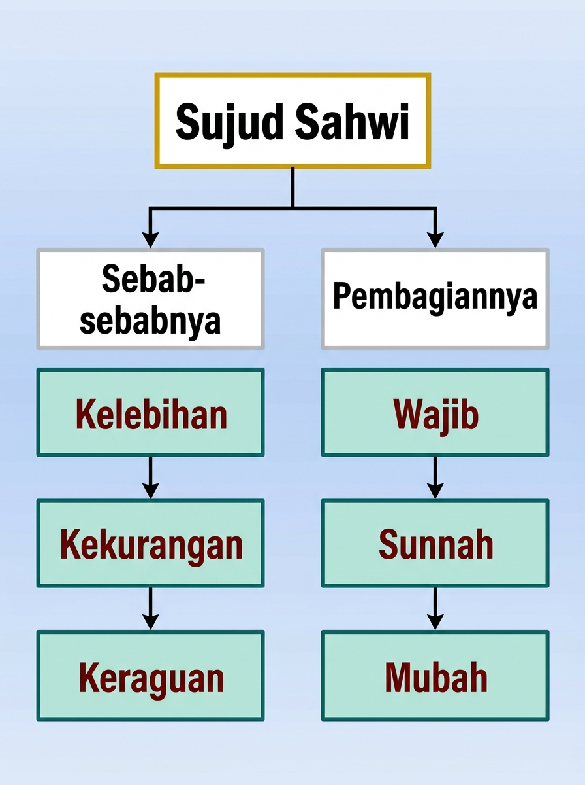

# Bab Sujud Sahwi **(1)**

*Ketika shalat, kita kadang lupa sehingga tanpa sadar menambah atau mengurangi gerakan shalat. Pada bab ini kita akan belajar tentang sujud sahwi sebagai cara untuk menambal kekurangan atau kesalahan tersebut agar shalat kita tetap sah dan sesuai tuntunan.*

### Matan

Sujud sahwi disyariatkan **(2)** karena adanya kelebihan, kekurangan, dan keraguan **(3)** — bukan karena disengaja **(4)** — baik dalam shalat Fardhu maupun shalat Nafilah **(5)**.

Kapan saja seseorang menambah suatu perbuatan yang termasuk gerakan shalat — seperti berdiri, duduk, ruku', atau sujud — secara sengaja, maka shalatnya batal. Namun jika dilakukan karena lupa, maka ia sujud untuk itu **(6)**.

Jika seseorang menambah satu rakaat dan baru menyadarinya setelah selesai dari rakaat tersebut, maka ia sujud **(7)**. Namun jika ia menyadarinya di tengah-tengah rakaat tambahan itu, hendaklah ia langsung duduk saat itu juga **(8)**, lalu membaca tasyahud jika sebelumnya belum tasyahud, kemudian sujud **(9)** dan salam.

Jika ada dua orang terpercaya yang mengingatkan imam dengan tasbih, lalu imam bersikeras melanjutkan dan tidak yakin dengan kebenaran shalatnya sendiri, maka batallah shalatnya serta shalat makmum yang mengikutinya jika makmum itu tahu **(10)** — bukan makmum yang tidak tahu, lupa, atau memisahkan diri (mufaraqah) darinya **(11)**.

Melakukan banyak gerakan berturut-turut menurut kebiasaan dari luar jenis gerakan shalat akan membatalkan shalat, baik dilakukan dengan sengaja maupun lupa **(12)**. Sedangkan gerakan ringan yang dilakukan karena lupa tidak disyariatkan sujud sahwi **(13)**. Shalat juga tidak batal karena makan atau minum sedikit akibat lupa **(14)**, dan shalat Nafilah tidak batal karena minum sedikit dengan sengaja **(15)**.

Apabila seseorang mengucapkan bacaan yang disyariatkan tetapi bukan pada tempatnya **(16)** — seperti membaca Al-Qur'an saat ruku' atau duduk, membaca tasyahud saat berdiri, atau membaca surah pada dua rakaat terakhir — maka shalatnya tidak batal dan tidak wajib baginya sujud sahwi, melainkan hanya disyariatkan (sunnah) **(17)**.

Jika seseorang salam sebelum menyempurnakan shalatnya dengan sengaja, maka shalatnya batal. Namun jika karena lupa lalu ingat dalam waktu yang dekat, hendaklah ia menyempurnakan shalatnya **(18)** kemudian sujud sahwi. Jika jeda waktunya sudah lama **(19)**, atau ia berbicara bukan untuk kemaslahatan shalat **(20)**, maka shalatnya batal **(21)** seperti halnya berbicara di tengah-tengah shalat. Namun jika ia berbicara sedikit demi kemaslahatan shalat, maka shalatnya tidak batal **(22)**.

Tertawa terbahak-bahak hukumnya sama seperti berbicara **(23)**. Jika seseorang meniup, menangis keras **(24)** bukan karena takut kepada Allah Ta'ala, atau berdeham tanpa keperluan **(25)** sehingga terdengar dua huruf, maka shalatnya batal.

---

### Catatan Kaki

**(1)** Sahwi secara bahasa berarti lalai terhadap sesuatu dan berpalingnya hati kepada hal lain. Secara syariat, sahwi berarti lupa di dalam shalat. Hikmah disyariatkannya sujud sahwi adalah untuk meraih ridha Allah Yang Maha Pengasih, menambal kekurangan dalam shalat, dan membuat setan marah. Termasuk keindahan agama Islam adalah orang yang lupa tidak mendapat kesulitan dan tidak berdosa, sebagaimana firman Allah Ta'ala:

﴿ رَبَّنَا لَا تُؤَاخِذْنَا إِن نَّسِينَا أَوْ أَخْطَأْنَا ﴾
(QS. Al-Baqarah: 286)
*"Ya Tuhan kami, janganlah Engkau hukum kami jika kami lupa atau kami salah."*

Dan Nabi ﷺ bersabda:

«عُفِيَ لِأُمَّتِي عَنِ الْخَطَأِ وَالنِّسْيَانِ»
(HR. Ibnu Majah, Ibnu Hibban, dan Al-Hakim; beliau menshahihkannya)
*"Dimaafkan bagi umatku kesalahan yang tidak disengaja dan kelupaan."*

**(2)** Maksudnya, hukum sujud sahwi terkadang wajib dan terkadang sunnah. Contoh yang sunnah adalah jika seseorang yang ingin melakukan qashar justru menyempurnakan shalatnya, maka ia sujud sahwi.

**(3)** Inilah sebab-sebab sujud sahwi.

**(4)** Maksudnya, tidak disyariatkan sujud sahwi jika orang yang shalat sengaja menambah atau mengurangi sesuatu dalam shalatnya. Sebab, orang yang melakukannya dengan sengaja tidak dimaafkan dan kesengajaannya itu membatalkan shalat.

**(5)** Maksudnya, sujud sahwi disyariatkan dalam shalat Nafilah sebagaimana disyariatkan dalam shalat Fardhu, karena dalil-dalilnya bersifat umum.

**(6)** Ini adalah bagian pertama dari hal-hal yang disyariatkan sujud sahwi, yaitu **kelebihan**, berdasarkan sabda Nabi ﷺ:

«فَإِذَا زَادَ الرَّجُلُ أَوْ نَقَصَ فِي صَلَاتِهِ فَلْيَسْجُدْ سَجْدَتَيْنِ»
(HR. Muslim)
*"Apabila seseorang menambah atau mengurangi dalam shalatnya, hendaklah ia sujud dua kali."*

**(7)** Maksudnya, ia sujud sahwi.

**(8)** Maksudnya, jika di tengah rakaat tersebut ia sadar bahwa rakaat itu adalah tambahan, maka ia wajib langsung duduk saat itu juga tanpa bertakbir. Sebab, jika ia tidak kembali duduk, berarti ia menambah shalat dengan sengaja, dan hal itu membatalkan shalatnya.

**(9)** Maksudnya, ia sujud sahwi.

**(10)** Contohnya: seorang imam lupa dalam shalatnya sehingga menambah atau mengurangi gerakan shalat. Lalu dua orang yang adil atau lebih mengingatkannya dengan mengucapkan *Subhanallah*, namun ia tidak mau kembali. Maka shalat imam itu batal jika ia tidak yakin bahwa dirinya benar. Adapun shalat makmum yang tetap mengikutinya dalam kelebihan atau kekurangan tersebut menjadi batal dengan dua syarat:
- **a.** Jika ia mengetahui adanya kelebihan atau kekurangan tersebut.
- **b.** Jika ia juga mengetahui hukumnya, yaitu bahwa menambah atau mengurangi dalam shalat secara sengaja membatalkan shalat.

**(11)** Maksudnya, makmum yang yakin imamnya salah boleh berniat berpisah (mufaraqah) dari imamnya dan menyempurnakan shalatnya sendiri, dan shalatnya sah. Demikian pula makmum yang jahil (tidak tahu hukumnya) atau lupa, shalatnya tetap sah karena ia dimaafkan dalam mengikuti imamnya.

**(12)** Ini adalah bagian kedua dari penambahan perbuatan dalam shalat, yaitu menambah perbuatan yang bukan bagian dari gerakan shalat, seperti berjalan, berkipas-kipas, menggaruk, memakai atau merapikan pakaian, banyak bergerak, dan banyak bermain-main. Hal seperti itu membatalkan shalat jika menurut kebiasaan dianggap banyak, karena memutus kesinambungan antar-rukun dan karena khusyuk dalam shalat dituntut oleh syariat, sedangkan bermain-main bertentangan dengan hal itu — kecuali jika ada kebutuhan atau darurat, seperti rasa takut, lari dari banjir, kebakaran, musuh, atau binatang buas, karena keadaan darurat membolehkan hal-hal yang terlarang.

**(13)** Maksudnya, gerakan ringan yang tidak disengaja (lupa), karena tidak ada dalil syariat tentang sujud sahwi untuk hal itu, tidak tepat disamakan dengan hal-hal yang ada tuntunan sujudnya, dan karena sulit untuk menghindarinya.

**(14)** Maksudnya, shalat Fardhu maupun Nafilah tidak batal karena makan atau minum sedikit akibat lupa, berdasarkan firman Allah Ta'ala:

﴿ رَبَّنَا لَا تُؤَاخِذْنَا إِن نَّسِينَا أَوْ أَخْطَأْنَا ﴾
(QS. Al-Baqarah: 286)
*"Ya Tuhan kami, janganlah Engkau hukum kami jika kami lupa atau kami salah."*

Dan sabda Nabi ﷺ:

«عُفِيَ لِأُمَّتِي عَنِ الْخَطَأِ وَالنِّسْيَانِ وَمَا اسْتُكْرِهُوا عَلَيْهِ»
*"Dimaafkan bagi umatku kesalahan yang tidak disengaja, kelupaan, dan apa yang dipaksakan atas mereka."*

**(15)** Maksudnya, shalat Nafilah tidak batal jika orang yang shalat meminum sedikit dengan sengaja di dalamnya.

**(16)** Ini adalah awal pembahasan tentang penambahan ucapan dalam shalat.

**(17)** Maksudnya, jika seseorang melakukan hal itu dengan sengaja, shalatnya tidak batal. Jika ia melakukannya karena lupa, tidak wajib baginya sujud sahwi, namun jika ia sujud, maka tidak mengapa.

**(18)** Jika ia belum ingat sampai ia berbalik menghadap makmum, maka ia wajib menghadap kiblat terlebih dahulu sebelum berdiri untuk menyempurnakan kekurangan shalatnya. Jika ia belum ingat sampai ia sudah berdiri, hendaklah ia duduk terlebih dahulu agar dapat bangkit menunaikannya dengan niat, karena berdiri itu wajib untuk shalat.

**(19)** Maksudnya, lama menurut kebiasaan (`'urf`), karena seluruhnya adalah satu rangkaian shalat sehingga tidak boleh menyambung bagian satu dengan bagian lainnya jika jedanya sudah lama.

**(20)** Seperti ucapannya: "Hai anak muda, ambilkan aku minum," atau "Di mana si Fulan?" dan semisalnya.

**(21)** Berdasarkan sabda Nabi ﷺ:

«إِنَّ صَلَاتَنَا هَٰذِهِ لَا يَصْلُحُ فِيهَا شَيْءٌ مِنْ كَلَامِ الْآدَمِيِّينَ»
(HR. Muslim)
*"Sesungguhnya shalat kita ini tidak pantas di dalamnya ada sedikit pun ucapan manusia."*

**(22)** Berbicara demi kemaslahatan shalat diperbolehkan sekadar kebutuhan. Sebab, ketika Rasulullah ﷺ shalat empat rakaat namun baru dua rakaat sudah salam, para sahabat berbicara kepada beliau dan beliau pun berbicara kepada mereka.

**(23)** Maksudnya, tertawa terbahak-bahak membatalkan shalat baik dilakukan dengan sengaja maupun lupa, bahkan lebih utama untuk membatalkan shalat daripada berbicara karena merusak kehormatan shalat.

**(24)** *Al-Intihab* artinya mengeraskan suara saat menangis.

**(25)** Berdasarkan perkataan Ali radhiyallahu 'anhu:

«كَانَ لِي مَدْخَلَانِ مِنْ رَسُولِ اللَّهِ ﷺ بِاللَّيْلِ وَالنَّهَارِ، فَإِذَا دَخَلْتُ عَلَيْهِ وَهُوَ يُصَلِّي يَتَنَحْنَحُ لِي»
(HR. Ahmad dan lainnya)
*"Aku memiliki dua waktu masuk menemui Rasulullah ﷺ di malam dan siang hari; apabila aku masuk menemui beliau saat beliau sedang shalat, beliau berdeham untukku."*

Namun, berdeham di dalam shalat tanpa keperluan hukumnya Makruh.

**Faidah-Faidah:**
- **Pertama:** Imam shalat tidak wajib kembali mengikuti orang yang mengingatkannya tentang kelebihan atau kekurangan dalam lima keadaan:
  1. Jika imam yakin dirinya benar, karena keyakinannya sendiri lebih didahulukan daripada keyakinan makmum.
  2. Jika yang mengingatkan hanya satu orang, karena Rasulullah ﷺ tidak langsung kembali hanya karena ucapan Dzulyadain seorang.
  3. Jika yang mengingatkannya adalah dua orang fasik.
  4. Jika orang-orang yang mengingatkan saling berbeda pendapat, maka ucapan mereka gugur seperti dua bukti yang saling bertentangan.
  5. Jika kembalinya imam adalah untuk menambal kekurangan, misalnya ia bangkit sebelum tasyahud awal; apabila ia diingatkan setelah berdiri tegak lalu ia tidak kembali duduk, maka hal itu tidak merusak shalatnya maupun shalat makmum di belakangnya.
- **Kedua:** Jika orang yang shalat dikalahkan oleh batuk, bersin, menguap, atau menangis (tidak bisa menahannya), maka hal itu tidak membahayakan shalatnya meskipun keluar dua huruf darinya.
- **Ketiga:** Pembagian sujud sahwi ada tiga:
  1. **Wajib:** Ketika seseorang lupa sehingga menambah atau mengurangi gerakan dalam shalat.
  2. **Sunnah:** Ketika seseorang mengucapkan bacaan yang disyariatkan bukan pada tempatnya karena lupa, seperti membaca Al-Qur'an saat ruku' atau sujud, membaca tasyahud saat berdiri, dan semisalnya.
  3. **Mubah:** Ketika seseorang meninggalkan sunnah ucapan atau perbuatan karena lupa. Jika dilakukan sengaja shalatnya tetap sah, dan jika lupa tidak ada sujud sahwi atasnya; namun jika ia sujud maka tidak mengapa.

---

## Fasal **(1)**

### Matan

Barang siapa meninggalkan satu rukun lalu baru ingat setelah mulai membaca Al-Qur'an pada rakaat berikutnya, maka rakaat yang rukunnya tertinggal itu batal **(2)**. Jika ia ingat sebelumnya (sebelum membaca rakaat berikutnya), ia wajib kembali untuk mengerjakan rukun yang tertinggal beserta gerakan setelahnya **(3)**. Jika ia baru tahu setelah salam, maka keadaannya seperti meninggalkan satu rakaat penuh **(4)**.

Barang siapa lupa tasyahud awal lalu bangkit berdiri, ia wajib kembali duduk selama belum berdiri tegak. Apabila ia sudah berdiri tegak, Makruh baginya kembali duduk. Jika belum berdiri tegak, ia wajib kembali duduk; namun jika ia sudah mulai membaca Al-Qur'an (Al-Fatihah), Haram baginya kembali duduk **(5)**, dan dalam semua keadaan itu ia wajib sujud sahwi **(6)**.

Barang siapa ragu **(7)** dalam jumlah rakaat, hendaklah ia mengambil jumlah yang paling sedikit **(8)**. Jika ia ragu meninggalkan suatu rukun, maka dianggap seperti meninggalkannya **(9)**, dan ia tidak sujud sahwi karena ragu meninggalkan sesuatu yang wajib **(10)** atau ragu melakukan kelebihan **(11)**.

Tidak ada kewajiban sujud sahwi bagi makmum kecuali mengikuti imamnya **(12)**. Sujud sahwi untuk hal yang jika disengaja dapat membatalkan shalat hukumnya Wajib **(13)**. Shalat menjadi batal hanya jika seseorang sengaja meninggalkan sujud sahwi yang tempat utamanya adalah sebelum salam **(14)** saja **(15)**. Jika ia lupa lalu terlanjur salam, ia tetap sujud sahwi selama waktunya belum lama **(16)**. Dan barang siapa lupa berkali-kali dalam satu shalat, cukup baginya dua kali sujud sahwi **(17)**.

---

### Catatan Kaki

**(1)** Ini adalah bagian kedua dari hal-hal yang disyariatkan sujud sahwi, yaitu **kekurangan** dalam shalat.

**(2)** Maksudnya, rukun selain takbiratul ihram. Sebab, jika seseorang meninggalkan takbiratul ihram, shalatnya belum sah dimulai. Adapun jika yang ditinggalkan adalah rukun selainnya, lalu ia baru ingat setelah mulai membaca bacaan di rakaat berikutnya, maka rakaat yang tertinggal rukunnya itu dianggap gugur dan rakaat berikutnya menggantikan posisinya.

**(3)** Maksudnya, jika orang yang shalat ingat rukun yang ia tinggalkan sebelum mulai membaca bacaan rakaat berikutnya, ia wajib kembali mengerjakan rukun yang tertinggal itu beserta gerakan-gerakan setelahnya, karena rukun tidak bisa gugur hanya karena lupa. Jika ia sengaja tidak kembali, batallah shalatnya; jika karena lupa, batallah rakaat tersebut dan rakaat berikutnya menjadi penggantinya.

**(4)** Maksudnya, ia baru mengetahui rukun yang tertinggal itu setelah salam, maka ia wajib menambah satu rakaat penuh lalu sujud sahwi.

**(5)** Jika ia tetap kembali duduk padahal ia tahu hukumnya dan melakukannya dengan sengaja, batallah shalatnya.

**(6)** Maksudnya, pada keadaan-keadaan yang telah disebutkan mengenai tasyahud awal dan duduknya, berdasarkan hadits Al-Mughirah bin Syu'bah radhiyallahu 'anhu, ia berkata: Rasulullah ﷺ bersabda:

«إِذَا قَامَ أَحَدُكُمْ مِنَ الرَّكْعَتَيْنِ فَلَمْ يَسْتَتِمَّ قَائِمًا فَلْيَجْلِسْ، وَإِنِ اسْتَتَمَّ قَائِمًا فَلَا يَجْلِسْ، وَلْيَسْجُدْ سَجْدَتَيْنِ»
(HR. Ahmad, Abu Dawud, Ibnu Majah, Al-Baihaqi, dan Ad-Daruquthni)
*"Apabila salah seorang di antara kalian bangkit dari dua rakaat dan belum berdiri tegak, hendaklah ia duduk. Apabila sudah berdiri tegak, janganlah ia duduk, dan hendaklah ia sujud dua kali (sujud sahwi)."*

**(7)** Ini adalah bagian ketiga dari hal-hal yang disyariatkan sujud sahwi, yaitu **keraguan**.

**(8)** Maksudnya, jika ia ragu apakah sudah shalat tiga atau empat rakaat, hendaklah ia menetapkan tiga rakaat karena itulah yang diyakini, berdasarkan hadits Abu Sa'id radhiyallahu 'anhu, ia berkata: Rasulullah ﷺ bersabda:

«إِذَا شَكَّ أَحَدُكُمْ فِي صَلَاتِهِ فَلَمْ يَدْرِ كَمْ صَلَّى ثَلَاثًا أَمْ أَرْبَعًا، فَلْيَطْرَحِ الشَّكَّ، وَلْيَبْنِ عَلَى مَا اسْتَيْقَنَ، ثُمَّ يَسْجُدُ سَجْدَتَيْنِ قَبْلَ أَنْ يُسَلِّمَ، فَإِنْ كَانَ صَلَّى خَمْسًا شَفَعْنَ لَهُ صَلَاتَهُ، وَإِنْ كَانَ صَلَّى إِتْمَامًا لِأَرْبَعٍ كَانَتَا إِرْغَامًا لِلشَّيْطَانِ»
(HR. Muslim dan para penyusun kitab Sunan)
*"Apabila salah seorang di antara kalian ragu dalam shalatnya, sehingga tidak tahu berapa rakaat ia telah shalat: tiga atau empat, hendaklah ia membuang keraguan dan berpegang pada apa yang ia yakini. Kemudian hendaklah ia sujud dua kali sebelum salam. Jika ternyata ia shalat lima rakaat, maka dua sujud itu menggenapkan shalatnya; dan jika ternyata ia shalat genap empat rakaat, maka dua sujud itu menjadi penghinaan bagi setan."*

**(9)** Maksudnya, orang yang shalat itu harus mengerjakan rukun yang diragukan tertinggal tersebut beserta gerakan-gerakan setelahnya, kecuali jika ia sudah mulai membaca bacaan pada rakaat berikutnya — maka rakaat berikutnya itu menjadi penggantinya dan rakaat yang diragukan tertinggal rukunnya itu dianggap batal.

**(10)** Maksudnya, ia tidak sujud sahwi apabila ragu dalam meninggalkan suatu perkara wajib dari kewajiban-kewajiban shalat, karena hukum asalnya tidak ada kewajiban sujud sahwi.

**(11)** Maksudnya, tidak disyariatkan sujud sahwi apabila ia ragu apakah ia menambah ruku' atau sujud, atau ragu saat tasyahud akhir apakah ia shalat empat atau lima rakaat, karena hukum asalnya tidak ada penambahan — kecuali jika ia ragu tentang tambahan tersebut tepat pada saat sedang melakukannya, seperti ragu pada suatu sujud saat ia sedang bersujud apakah sujud itu tambahan atau bukan, atau pada rakaat terakhir dengan keadaan serupa, maka ia sujud sahwi karena ia melakukan bagian dari shalatnya dalam keadaan ragu apakah bagian itu termasuk shalatnya atau bukan.

**(12)** Maksudnya, apabila makmum masuk bersama imam sejak awal shalat. Adapun makmum masbuq (terlambat), apabila ia lupa bersama imam atau lupa pada rakaat yang ia sempurnakan setelah salamnya imam, maka ia wajib melakukan sujud sahwi. Jika makmum masbuq sudah berdiri untuk menyempurnakan rakaatnya yang tertinggal lalu imamnya melakukan sujud sahwi, maka hukum kembalinya makmum tersebut sama seperti hukum orang yang lupa tasyahud awal.

**(13)** Ini adalah kaidah dalam sujud sahwi, yaitu: **setiap perbuatan atau peninggalan yang jika disengaja dapat membatalkan shalat, maka apabila dilakukan karena lupa, sujud sahwinya menjadi Wajib.** Contohnya: jika seseorang meninggalkan satu wajib dari kewajiban shalat secara sengaja maka shalatnya batal, sedangkan jika ia meninggalkannya karena lupa maka wajib baginya sujud sahwi.

**(14)** Sujud sahwi sebelum salam maupun sesudah salam keduanya boleh, namun melakukannya sebelum salam lebih utama kecuali dalam dua keadaan:
- **a.** Apabila imam salam dalam keadaan kurang satu rakaat atau lebih.
- **b.** Apabila imam ragu lalu berpegang pada dugaan yang lebih kuat.

**(15)** Maksudnya, shalat tidak batal apabila orang yang shalat sengaja meninggalkan sujud sahwi yang tempat utamanya adalah setelah salam.

**(16)** Maksudnya, jika seseorang lupa sujud sahwi yang tempatnya sebelum salam, maka ia mengulanginya (melakukannya setelah salam) dengan tiga syarat:
- **a.** Masih berada di dalam masjid.
- **b.** Jeda waktunya belum lama.
- **c.** Wudhunya belum batal.

**(17)** Maksudnya, dua sujud itu sudah mencukupi untuk seluruh kelupaannya.

---

## Pertanyaan (As-ilah)

1. Jelaskan hukum dari hal-hal berikut ini:
   - a. Jika seseorang mengetahui bahwa suatu rakaat adalah rakaat tambahan, namun ia tidak mau kembali (duduk).
   - b. Makan atau minum sedikit di dalam shalat.
   - c. Jika seseorang berkata di dalam shalat: "Wahai fulan, ambilkan aku minum."
   - d. Jika seseorang membaca Al-Qur'an saat ruku' atau sujud.
2. Lengkapilah bagian yang kosong berikut ini:
   - *Sahwi secara bahasa adalah: ............ terhadap ........ dan berpalingnya ...... menuju .........; al-intihab adalah .... suara .......; barang siapa ragu dalam jumlah rakaat ..........................; dan jika ia ragu dalam meninggalkan ......... maka dianggap seperti meninggalkannya.*
3. Pensyarah menyebutkan sebuah kaidah yang bermanfaat untuk mengetahui hukum sujud sahwi, apakah kaidah tersebut?
4. Tentukan mana yang benar dan betulkan yang salah dari pernyataan berikut ini:
   - a. Jika seseorang lupa sujud sahwi, maka ia mengulanginya meskipun wudhunya telah batal. (   )
   - b. Jika seseorang ragu dalam meninggalkan satu kewajiban di antara kewajiban-kewajiban shalat, maka ia sujud sahwi. (   )
   - c. Pembagian sujud sahwi ada tiga. (   )
   - d. Barang siapa lupa tasyahud awal lalu baru ingat setelah mulai membaca bacaan pada rakaat berikutnya, maka Haram baginya untuk kembali duduk. (   )
5. Ketika imam diingatkan atas adanya kelebihan atau kekurangan lalu ia tidak mau kembali, maka apa yang harus dilakukan makmum?
6. Disebutkan bahwa sujud sahwi adalah: membuat Allah Yang Maha Pengasih ridha, menambal kekurangan, dan membuat setan marah. Jelaskan makna-makna tersebut!
7. Diskusikan permasalahan berikut dan jelaskan hukumnya berdasarkan pelajaranmu pada bab ini:
   - a. Orang yang menyibukkan diri di dalam shalatnya dengan urusan-urusan yang tidak ada hubungannya dengan shalat.
   - b. Seseorang tidak pernah shalat satu kali pun kecuali ia selalu melakukan sujud sahwi di dalamnya.
   - c. Sebagian imam menyebabkan kebingungan pada jamaah karena sujud sahwi mereka dilakukan setelah salam.
