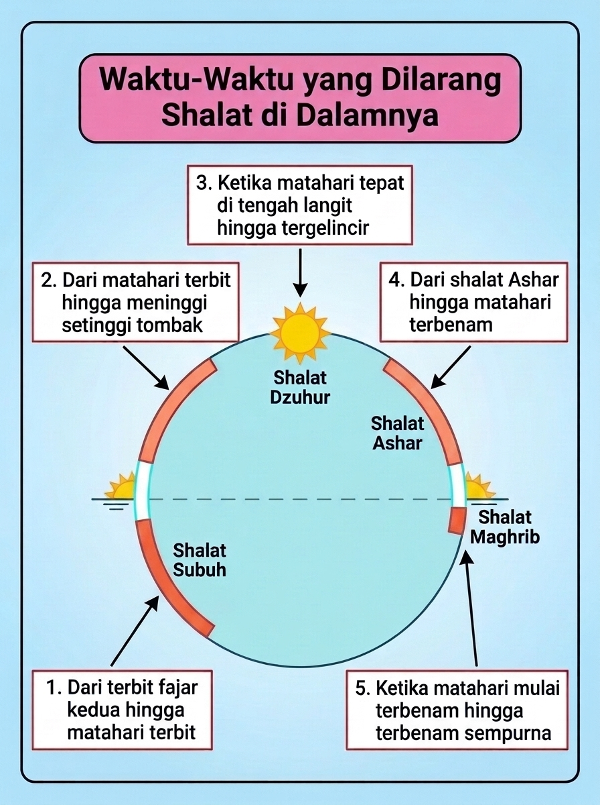

# Bab Shalat Tathawwu' **(1)**

*Selain shalat wajib lima waktu, Allah juga mensyariatkan banyak shalat sunnah (Tathawwu') untuk menambah pahala dan menyempurnakan kekurangan shalat wajib kita nanti di hari kiamat. Di bab ini kita akan belajar tentang shalat Witir, doa Qunut, shalat Tarawih, shalat Rawatib, shalat Dhuha, sujud tilawah, sujud syukur, serta waktu-waktu yang dilarang untuk shalat sunnah.*

### Matan

Shalat Tathawwu' yang paling ditekankan adalah shalat Kusuf (gerhana) **(2)**, kemudian Istisqa', kemudian Tarawih, kemudian Witir **(3)** yang dikerjakan antara shalat Isya' hingga terbit fajar **(4)**. Jumlah rakaatnya paling sedikit satu rakaat dan paling banyak sebelas rakaat **(5)**, dikerjakan dua rakaat demi dua rakaat **(6)**, lalu ditutup dengan satu rakaat Witir.

Jika seseorang shalat Witir lima atau tujuh rakaat sekaligus, ia tidak duduk tasyahud kecuali di rakaat terakhirnya. Jika sembilan rakaat, ia duduk tasyahud setelah rakaat kedelapan lalu bertasyahud tanpa salam, kemudian berdiri mengerjakan rakaat kesembilan lalu bertasyahud dan salam **(7)**.

Kesempurnaan minimal shalat Witir adalah tiga rakaat **(8)** dengan dua kali salam **(9)**; pada rakaat pertama membaca surah *Al-A'la* (*Sabbih*), pada rakaat kedua membaca *Al-Kafirun*, dan pada rakaat ketiga membaca *Al-Ikhlas* **(10)**.

Ia membaca doa Qunut di dalamnya setelah ruku' **(11)** dengan mengucapkan:

«اللَّهُمَّ اهْدِنِي فِيمَنْ هَدَيْتَ، وَعَافِنِي فِيمَنْ عَافَيْتَ، وَتَوَلَّنِي فِيمَنْ تَوَلَّيْتَ، وَبَارِكْ لِي فِيمَا أَعْطَيْتَ، وَقِنِي شَرَّ مَا قَضَيْتَ، إِنَّكَ تَقْضِي وَلَا يُقْضَى عَلَيْكَ، إِنَّهُ لَا يَذِلُّ مَنْ وَالَيْتَ، وَلَا يَعِزُّ مَنْ عَادَيْتَ، تَبَارَكْتَ رَبَّنَا وَتَعَالَيْتَ، اللَّهُمَّ إِنِّي أَعُوذُ بِرِضَاكَ مِنْ سَخَطِكَ، وَبِعَفْوِكَ مِنْ عُقُوبَتِكَ، وَبِكَ مِنْكَ، لَا أُحْصِي ثَنَاءً عَلَيْكَ أَنْتَ كَمَا أَثْنَيْتَ عَلَى نَفْسِكَ»
*"Ya Allah, berilah aku petunjuk sebagaimana orang-orang yang telah Engkau beri petunjuk **(12)**, berilah aku kesehatan sebagaimana orang-orang yang telah Engkau beri kesehatan, lindungilah aku sebagaimana orang-orang yang telah Engkau lindungi, berkahilah untukku apa yang telah Engkau berikan **(13)**, dan jagalah aku dari keburukan apa yang telah Engkau tetapkan **(14)**. Sesungguhnya Engkaulah yang menetapkan dan tidak ada yang dapat menetapkan hukum atas-Mu **(15)**; sesungguhnya tidak akan hina orang yang Engkau lindungi dan tidak akan mulia orang yang Engkau musuhi **(16)**. Maha Berkah Engkau **(17)** wahai Tuhan kami dan Maha Tinggi Engkau **(18)**. Ya Allah, aku berlindung dengan keridhaan-Mu dari kemurkaan-Mu, dengan ampunan-Mu dari siksa-Mu, dan aku berlindung kepada-Mu dari-Mu **(19)**. Aku tidak mampu menghitung pujian atas-Mu; Engkau adalah sebagaimana Engkau memuji diri-Mu sendiri **(20)**."*

Kemudian membaca shalawat **(21)** atas Nabi Muhammad dan keluarga beliau **(22)**, lalu mengusap wajahnya dengan kedua tangannya **(23)**.

Makruh hukumnya membaca Qunut selain pada shalat Witir **(24)**, kecuali jika kaum muslimin ditimpa musibah besar (*nazilah*) **(25)** — selain wabah tha'un **(26)** — maka imam membaca Qunut **(27)** dalam shalat-shalat Fardhu **(28)**.

Shalat Tarawih berjumlah dua puluh rakaat **(29)** yang dikerjakan secara berjamaah bersama shalat Witir setelah shalat Isya' di bulan Ramadhan **(30)**, dan orang yang shalat Tahajud mengerjakannya (Witir) setelah Tahajudnya **(31)**. Jika ia mengikuti imamnya (shalat Witir bersama imam lalu ingin Tahajud lagi), ia menggenapkan Witir imam tersebut dengan satu rakaat lagi **(32)**. Makruh mengerjakan shalat sunnah di antara rakaat-rakaat Tarawih **(33)**, tetapi tidak Makruh mengerjakan shalat malam berjamaah (*ta'qib*) setelahnya **(34)**.

Kemudian shalat-shalat Sunnah Rawatib **(35)**: dua rakaat sebelum Dzuhur **(36)**, dua rakaat sesudahnya, dua rakaat sesudah Maghrib, dua rakaat sesudah Isya', dan dua rakaat sebelum Subuh — dan dua rakaat sebelum Subuh inilah yang paling ditekankan **(37)**. Barang siapa terlewat salah satunya, disunnahkan baginya untuk mengqadhanya.

Shalat malam lebih utama daripada shalat siang **(38)**, dan waktu yang paling utama adalah sepertiga malam setelah pertengahannya. Shalat sunnah malam maupun siang dikerjakan dua rakaat demi dua rakaat, dan jika shalat sunnah di siang hari empat rakaat seperti shalat Dzuhur maka tidak mengapa. Pahala shalat sambil duduk **(39)** adalah setengah dari pahala shalat sambil berdiri.

Disunnahkan pula shalat Dhuha **(40)**, paling sedikit dua rakaat dan paling banyak delapan rakaat **(41)**, waktunya sejak keluar dari waktu terlarang **(42)** hingga sesaat sebelum matahari tergelincir (menjelang Dzuhur).

Sujud tilawah adalah shalat **(43)**; disunnahkan bagi yang membaca dan yang menyimak, bukan yang sekadar mendengar tanpa sengaja **(44)**. Jika orang yang membaca Al-Qur'an tidak sujud, maka pendengar juga tidak sujud. Jumlah ayat sajdah ada empat belas tempat, dua di antaranya terdapat di dalam surah Al-Hajj **(45)**. Orang yang sujud tilawah bertakbir ketika hendak sujud dan ketika bangkit darinya, lalu duduk dan mengucapkan salam tanpa membaca tasyahud **(46)**. Makruh bagi imam membaca ayat sajdah dalam shalat sirriyah (bacaan pelan) **(47)**, dan makmum wajib mengikutinya apabila imam sujud di selain shalat sirriyah **(48)**.

Dianjurkan melakukan sujud syukur ketika mendapat nikmat baru atau terhindar dari musibah **(49)**. Shalat menjadi batal jika seseorang melakukan sujud syukur di tengah shalat, kecuali bagi orang yang tidak tahu hukumnya atau lupa **(50)**.

Waktu-waktu yang dilarang untuk shalat ada lima:
1. Dari terbitnya fajar kedua **(51)** hingga matahari terbit.
2. Dari terbitnya matahari hingga meninggi setinggi tombak.
3. Ketika matahari berada tepat di tengah langit **(52)** hingga tergelincir.
4. Dari shalat Ashar hingga matahari terbenam **(53)**.
5. Ketika matahari mulai terbenam hingga terbenam sempurna **(54)**.

Diperbolehkan mengqadha shalat Fardhu pada waktu-waktu tersebut **(55)**. Dan pada tiga waktu terlarang yang pendek **(56)** diperbolehkan mengerjakan shalat dua rakaat thawaf **(57)** serta mengulang shalat berjamaah **(58)**. Haram hukumnya mengerjakan shalat Tathawwu' selain itu **(59)** pada salah satu dari lima waktu terlarang tersebut, bahkan shalat sunnah yang memiliki sebab sekalipun **(60)**.

---

### Catatan Kaki

**(1)** Tathawwu' secara bahasa artinya melakukan ketaatan. Secara syariat artinya ketaatan yang tidak wajib. Mengingat shalat Fardhu merupakan rukun Islam yang paling ditekankan setelah dua kalimat syahadat, maka shalat Tathawwu' termasuk amalan yang paling utama di sisi Allah Ta'ala, karena menghimpun berbagai bentuk ibadah: keikhlasan, bacaan Al-Qur'an, ruku', sujud, bermunajat kepada Rabb Tabaraka wa Ta'ala, merendahkan diri, tunduk, bertasbih, dan bertakbir. Shalat Tathawwu' yang disunnahkan untuk dikerjakan secara berjamaah adalah yang paling utama. Selain itu, shalat Tathawwu' akan menyempurnakan kekurangan shalat Fardhu pada hari kiamat apabila seseorang belum menunaikannya secara sempurna, sebagaimana disebutkan dalam hadits hisab amal bahwa Allah Azza wa Jalla berfirman:

«انْظُرُوا هَلْ لِعَبْدِي مِنْ تَطَوُّعٍ؟ فَيُكْمَلُ بِهَا مَا انْتَقَصَ مِنَ الْفَرِيضَةِ ثُمَّ يَكُونُ سَائِرُ عَمَلِهِ عَلَى ذَٰلِكَ»
(HR. Lima Imam Ahli Hadits: Abu Dawud, Tirmidzi, Nasa'i, Ibnu Majah, dan Ahmad)
*"Lihatlah, apakah hamba-Ku memiliki shalat Tathawwu'? Lalu dengannya disempurnakan kekurangan dari shalat Fardhunya, kemudian seluruh amalnya dihitung dengan cara seperti itu."*

Shalat yang disyariatkan selain shalat lima waktu sangat banyak, di antaranya yang akan disebutkan oleh penulis rahimahullah, dan ditambahkan pula:
- **a.** Shalat Tahiyatul Masjid.
- **b.** Shalat Istikharah.
- **c.** Shalat dua rakaat setelah wudhu.
- **d.** Shalat dua rakaat setelah bangun dari tidur malam.

**(2)** Maksudnya, shalat Tathawwu' yang paling ditekankan, karena Rasulullah ﷺ sendiri mengerjakannya dan memerintahkannya, serta karena merupakan ibadah yang disepakati ulama dan murni ibadah.

**(3)** Berdasarkan hadits:

«أَوْتِرُوا يَا أَهْلَ الْقُرْآنِ؛ فَإِنَّ اللَّهَ وِتْرٌ يُحِبُّ الْوِتْرَ»
*"Berwitirlah wahai ahli Al-Qur'an, karena sesungguhnya Allah itu Witir (Ganjil/Esa) dan menyukai yang ganjil."*

Imam Ahmad rahimahullah berkata: "Barang siapa meninggalkan shalat Witir dengan sengaja, maka ia adalah orang yang buruk dan persaksiannya tidak layak diterima."

**(4)** Ini adalah penjelasan tentang waktu shalat Witir, yaitu sejak setelah shalat Isya' — meskipun dijamak taqdim bersama Maghrib — hingga terbit fajar kedua (Subuh). Jadi seluruh waktu malam adalah waktu bagi Witir, namun akhir malam adalah yang paling utama.

**(5)** Berdasarkan hadits Aisyah radhiyallahu 'anha:

«مَا كَانَ رَسُولُ اللَّهِ ﷺ يَزِيدُ فِي رَمَضَانَ وَلَا فِي غَيْرِهِ عَلَى إِحْدَى عَشْرَةَ رَكْعَةً»
(HR. Bukhari dan Muslim / Muttafaq 'Alaih)
*"Rasulullah ﷺ tidak pernah menambah jumlah rakaat (shalat malam), baik di bulan Ramadhan maupun di luar Ramadhan, lebih dari sebelas rakaat."*

**(6)** Maksudnya, mengucapkan salam setiap dua rakaat, berdasarkan hadits Abdullah bin Umar radhiyallahu 'anhuma, ia berkata: Rasulullah ﷺ bersabda:

«صَلَاةُ اللَّيْلِ مَثْنَى مَثْنَى، فَإِذَا خَشِيَ أَحَدُكُمُ الصُّبْحَ صَلَّى رَكْعَةً وَاحِدَةً، تُوتِرُ لَهُ مَا قَدْ صَلَّى»
(HR. Bukhari dan Muslim / Muttafaq 'Alaih)
*"Shalat malam itu dua rakaat demi dua rakaat. Apabila salah seorang di antara kalian khawatir masuk waktu Subuh, hendaklah ia shalat satu rakaat untuk mengganjilkan shalat yang telah ia kerjakan."*

**(7)** Yang lebih utama adalah mengucapkan salam setiap dua rakaat karena perintah Nabi ﷺ, kebiasaan beliau yang terus-menerus melakukannya, serta karena dalil haditsnya lebih kuat dan amalannya lebih banyak.

**(8)** Karena jumlah minimal yang dapat disebut bilangan jamak dalam hal ini adalah tiga rakaat.

**(9)** Maksudnya, mengerjakan dua rakaat lalu salam, kemudian mengerjakan rakaat ketiga lalu salam; inilah yang lebih utama karena dalilnya lebih kuat dan lebih kokoh. Namun jika ia langsung mengerjakan tiga rakaat dengan satu kali salam maka tidak mengapa, sedangkan mengerjakannya persis seperti shalat Maghrib (dengan dua tasyahud) lebih baik ditinggalkan.

**(10)** Maksudnya, disunnahkan bagi orang yang berwitir tiga rakaat untuk membaca surah-surah tersebut, dan boleh juga membaca surah lainnya.

**(11)** Qunut adalah doa untuk kebaikan maupun keburukan. Dikatakan *qanata lahu* jika mendoakan kebaikan, dan *qanata 'alaihi* jika mendoakan keburukan. Qunut dalam shalat Witir hukumnya Sunnah (mustahab). Boleh dibaca sebelum ruku' maupun setelah ruku' karena Nabi ﷺ pernah melakukan kedua-duanya, tetapi setelah ruku' lebih sering dilakukan, dan hendaknya tidak membingungkan para makmum.

**(12)** Maksudnya, sebagai penjagaku bersama orang-orang yang Engkau jaga. *(Catatan: keterangan pada teks asli menunjuk pada lafaz "wa tawallani fiman tawallait" = jadilah pelindung dan penjagaku sebagaimana orang-orang yang Engkau jaga).*

**(13)** Maksudnya, aku memohon kepada-Mu perkembangan dan tambahan keberkahan pada apa yang Engkau anugerahkan kepadaku berupa umur, harta, ilmu, dan amal.

**(14)** Maksudnya, selamatkanlah akal dan agamaku dari keburukan takdir dan ketetapan yang Engkau tentukan atasku.

**(15)** Maksudnya, Engkaulah yang berkuasa dan memutuskan segala sesuatu yang Engkau kehendaki; Maha Suci Engkau, tidak ada yang dapat menolak perintah-Mu, tidak ada yang dapat mengubah hukum-Mu, Engkau berbuat apa saja yang Engkau kehendaki dan menetapkan hukum sesuai kehendak-Mu.

**(16)** Maksudnya, tidak akan pernah menjadi mulia orang yang Engkau murkai/benci.

**(17)** Maksudnya, hanya milik-Mu wahai Rabb kesempurnaan berkah dan keagungan.

**(18)** Maksudnya, hanya milik-Mu wahai Rabb kesempurnaan ketinggian dan puncaknya. Doa inilah yang diajarkan oleh Rasulullah ﷺ kepada Al-Hasan bin Ali radhiyallahu 'anhuma.

**(19)** Doa ini berisi pengakuan atas kelemahan diri, ketergantungan penuh, dan perlindungan kepada Allah Ta'ala semata, bukan kepada selain-Nya. Lafaz yang diriwayatkan dalam hadits adalah: *"wa bi mu'afatika min 'uqubatika, wa a'udzu bika minka..."* (dengan kesehatan/ampunan dari-Mu dari siksa-Mu, dan aku berlindung kepada-Mu dari-Mu...).

**(20)** Sebagai pengakuan atas ketidakmampuan dalam memuji Allah, dan menyerahkannya kepada ilmu Allah Yang Maha Meliputi segala sesuatu baik secara garis besar maupun rinci. Imam At-Tirmidzi rahimahullah berkata: "Kami tidak mengetahui ada bacaan Qunut dari Nabi ﷺ yang lebih baik daripada doa ini."

**(21)** Shalawat Allah Ta'ala kepada Nabi-Nya adalah pujian Allah kepada beliau di hadapan para malaikat di langit tertinggi (*al-mala'ul a'la*).

**(22)** Sunnahnya adalah bershalawat kepada Nabi ﷺ di awal doa, di pertengahannya, dan di akhirnya; dan Allah Ta'ala Maha Mulia untuk menolak doa yang diapit oleh dua shalawat tersebut.

**(23)** Yang lebih utama adalah tidak mengusap wajah dengan kedua tangan setelah berdoa, karena hadits-hadits yang menyebutkan hal itu lemah (*dha'if*). Namun tidak perlu mencela orang yang mengusap wajahnya, karena sebagian ulama menghasankan hadits-hadits tersebut.

**(24)** Maksudnya, Qunut pada shalat Subuh di luar kondisi *nazilah* (musibah besar) adalah bid'ah, berdasarkan riwayat Al-Baihaqi dari Ummu Salamah radhiyallahu 'anha bahwa Nabi ﷺ melarang Qunut pada shalat Subuh. Ad-Daruquthni juga meriwayatkan dari Sa'id bin Jubair, ia berkata: "Aku bersaksi atas Ibnu Abbas bahwa ia berkata: Qunut pada shalat Subuh adalah bid'ah." Namun jika seseorang shalat di belakang imam yang membaca Qunut Subuh, ia tetap mengikutinya dan mengaminkan doanya, berdasarkan hadits:

«إِنَّمَا جُعِلَ الْإِمَامُ لِيُؤْتَمَّ بِهِ، فَلَا تَخْتَلِفُوا عَلَيْهِ»
(HR. Bukhari)
*"Sesungguhnya imam itu dijadikan untuk diikuti, maka janganlah kalian menyelisihinya."*

**(25)** Maksudnya, musibah berat atau peristiwa besar yang Allah Ta'ala datangkan karena berbagai hikmah dan maslahat, di antaranya sebagai ujian dan cobaan bagi manusia.

**(26)** Setiap penyakit menular yang mematikan disebut *tha'un*. Di antara yang paling terkenal pada masa lalu adalah Tha'un Amwas yang terjadi di negeri Syam pada tahun ke-18 Hijriah. Dan pada abad ke-14 Hijriah adalah penyakit kolera. Tidak disyariatkan membaca Qunut untuk menghilangkan wabah ini, karena tidak ada riwayat dari para sahabat bahwa mereka melakukannya, dan karena siapa saja di antara kaum muslimin yang ditakdirkan Allah wafat akibat penyakit ini maka ia terhitung mati syahid.

**(27)** Atau wakil yang menggantikannya atas izin darinya.

**(28)** Maksudnya, Qunut nazilah disyariatkan setelah setiap shalat wajib lima waktu hingga musibah itu hilang, kecuali pada shalat Jum'at, karena hari Jum'at adalah hari raya kaum mukminin yang merupakan waktu kegembiraan dan kebahagiaan, serta karena sudah cukup dengan doa di dalam khutbah.

**(29)** Karena pada masa Khalifah Umar bin Khaththab radhiyallahu 'anhu, orang-orang melaksanakan shalat malam di bulan Ramadhan sebanyak dua puluh tiga rakaat. Hal ini tidak bertentangan dengan yang biasa dilakukan oleh Rasulullah ﷺ di bulan Ramadhan maupun di luar Ramadhan, yaitu sebelas rakaat. Penambahan jumlah rakaat tersebut hanyalah untuk menyesuaikan kondisi para makmum yang tidak sanggup berdiri terlalu lama, sehingga jumlah rakaatnya diperbanyak namun bacaannya diperingan. Diriwayatkan pula dari Umar radhiyallahu 'anhu bahwa beliau menetapkan bagi setiap imam jumlah ayat yang sesuai dengan kecepatan dan berat-ringannya bacaan mereka. Siapa saja yang menyangka bahwa shalat malam Ramadhan memiliki batasan rakaat tertentu yang tidak boleh ditambah atau dikurangi, maka ia telah keliru.

**(30)** Maksudnya, hukumnya Sunnah muakkadah di bulan Ramadhan, berdasarkan hadits:

«مَنْ قَامَ رَمَضَانَ إِيمَانًا وَاحْتِسَابًا غُفِرَ لَهُ مَا تَقَدَّمَ مِنْ ذَنْبِهِ»
(HR. Bukhari dan Muslim / Muttafaq 'Alaih)
*"Barang siapa menghidupkan malam Ramadhan karena iman dan mengharap pahala dari Allah, maka diampuni dosa-dosanya yang telah lalu."*

Juga berdasarkan kesepakatan para sahabat radhiyallahu 'anhum dan generasi setelah mereka atas hal tersebut.

**(31)** Maksudnya, setelah shalat Tahajudnya, berdasarkan sabda Rasulullah ﷺ:

«اجْعَلُوا آخِرَ صَلَاتِكُمْ بِاللَّيْلِ وِتْرًا»
(HR. Bukhari dan Muslim / Muttafaq 'Alaih)
*"Jadikanlah akhir shalat kalian di malam hari dengan shalat Witir."*

Orang yang bertahajud (*mutahajjid*) adalah orang yang mengerjakan shalat malam setelah ia tidur lalu bangun dari tidur malamnya.

**(32)** Maksudnya, ia menambah satu rakaat lagi setelah salamnya imam (sehingga menjadi genap), lalu ketika ia bangun di akhir malam ia berwitir setelah shalat Tahajudnya.

**(33)** Maksudnya, shalat sunnah sendiri di sela-sela shalat Tarawih. Diriwayatkan dari Abu Darda' radhiyallahu 'anhu bahwa ia melihat sekelompok orang shalat sendiri di antara rakaat Tarawih, lalu ia berkata: "Shalat apa ini?! Apakah engkau shalat sendiri padahal imammu ada di depanmu? Bukan termasuk golongan kami orang yang membenci sunnah kami."

**(34)** Maksudnya, tidak Makruh melakukan *ta'qib*, yaitu shalat berjamaah di akhir malam setelah selesai Tarawih; inilah yang sekarang dikerjakan kaum muslimin pada sepuluh malam terakhir bulan Ramadhan dan mereka menyebutnya shalat *Qiyam*.

**(35)** Maksudnya, keutamaannya berada setelah shalat Witir. Shalat Rawatib adalah Sunnah muakkadah dan Makruh ditinggalkan. Orang yang terus-menerus meninggalkannya gugur sifat keadilannya dan ditolak persaksiannya menurut Imam Ahmad dan Imam Syafi'i, serta menunjukkan kekurangan pada agamanya. Pembantu, istri, dan anak berhak mengerjakannya bersama shalat Fardhu dan tidak boleh dilarang.

**(36)** Terdapat riwayat bahwa shalat sunnah sebelum Dzuhur berjumlah empat rakaat, berdasarkan riwayat dari Ali radhiyallahu 'anhu bahwa Nabi ﷺ shalat empat rakaat sebelum Dzuhur dan dua rakaat sesudahnya. Imam At-Tirmidzi berkata: hadits ini hasan, dan diamalkan oleh mayoritas ahli ilmu dari kalangan sahabat dan generasi setelah mereka.

**(37)** Maksudnya, shalat Rawatib yang paling utama adalah dua rakaat sebelum Subuh (Fajar), berdasarkan perkataan Aisyah radhiyallahu 'anha:

«لَمْ يَكُنْ رَسُولُ اللَّهِ ﷺ عَلَى شَيْءٍ مِنَ النَّوَافِلِ أَشَدَّ تَعَاهُدًا مِنْهُ عَلَى رَكْعَتَيِ الْفَجْرِ»
(HR. Bukhari dan Muslim / Muttafaq 'Alaih)
*"Tidak ada satu pun shalat Nafilah yang lebih dijaga secara rutin oleh Rasulullah ﷺ melebihi dua rakaat sebelum Fajar (Subuh)."*

**(38)** Maksudnya, shalat malam menempati urutan keutamaan setelah shalat Witir dan shalat Rawatib, berdasarkan hadits Abu Hurairah radhiyallahu 'anhu, ia berkata: Rasulullah ﷺ bersabda:

«أَفْضَلُ الصَّلَاةِ بَعْدَ الْمَكْتُوبَةِ صَلَاةُ اللَّيْلِ»
(HR. Muslim)
*"Shalat yang paling utama setelah shalat wajib adalah shalat malam."*

**(39)** Maksudnya, shalat sunnah sambil duduk tanpa adanya uzur, berdasarkan hadits Imran bin Hushain radhiyallahu 'anhu bahwa ia bertanya kepada Nabi ﷺ tentang shalatnya seseorang sambil duduk, lalu beliau bersabda:

«إِنْ صَلَّى قَائِمًا فَهُوَ أَفْضَلُ، وَمَنْ صَلَّى قَاعِدًا فَلَهُ نِصْفُ أَجْرِ الْقَائِمِ»
(HR. Jamaah Ahli Hadits selain Muslim)
*"Jika ia shalat sambil berdiri maka itu lebih utama, dan barang siapa shalat sambil duduk maka baginya setengah pahala orang yang berdiri."*

**(40)** Berdasarkan hadits Abu Hurairah radhiyallahu 'anhu, ia berkata:

«أَوْصَانِي خَلِيلِي ﷺ بِثَلَاثٍ: بِصِيَامِ ثَلَاثَةِ أَيَّامٍ مِنْ كُلِّ شَهْرٍ، وَرَكْعَتَيِ الضُّحَى، وَأَنْ أُوتِرَ قَبْلَ أَنْ أَنَامَ»
(HR. Bukhari dan Muslim / Muttafaq 'Alaih)
*"Kekasihku ﷺ berwasiat kepadaku dengan tiga hal: berpuasa tiga hari setiap bulan, shalat Dhuha dua rakaat, dan shalat Witir sebelum tidur."*

**(41)** Karena pada tahun Penaklukan Kota Makkah (Fathu Makkah), Nabi ﷺ mengerjakan shalat Dhuha sebanyak delapan rakaat. Diriwayatkan oleh Jamaah Ahli Hadits dari Ummu Hani' radhiyallahu 'anha.

**(42)** Maksudnya, saat matahari sudah naik setinggi satu tombak menurut pandangan mata. Satu tombak sama dengan enam hasta, atau kira-kira sekitar tiga meter.

**(43)** Pendapat yang shahih adalah bahwa sujud tilawah bukanlah shalat, sehingga tidak disyaratkan padanya syarat-syarat shalat. Namun, bersujud dalam keadaan suci dan menghadap kiblat tetap lebih utama.

**(44)** *Mustami'* adalah orang yang sengaja menyimak bacaan Al-Qur'an, sedangkan *sami'* adalah kebalikannya (mendengar tanpa sengaja menyimak).

**(45)** Selebihnya terdapat pada surah Al-A'raf, Ar-Ra'd, An-Nahl, Maryam, Al-Furqan, An-Naml, As-Sajdah, Fushshilat, An-Najm, Al-Insyiqaq, dan Al-'Alaq. Adapun sujud pada surah Shad adalah sujud syukur, dan yang lebih utama sujud tersebut dilakukan di luar shalat.

**(46)** Pendapat yang benar adalah tidak disyariatkan takbiratul ihram, duduk, tasyahud, maupun salam dalam sujud tilawah. Pendapat ini dikemukakan oleh Ibnu Taimiyah dan Ibnul Qayyim rahimahumallah.

**(47)** Pendapat yang lebih kuat (*rajih*) adalah tidak Makruh, karena Nabi ﷺ pernah bersujud pada rakaat pertama shalat Dzuhur, sehingga para sahabat mengetahui bahwa beliau membaca surah As-Sajdah (*Tanzil as-Sajdah*). (HR. Ahmad dan Abu Dawud).

**(48)** Yaitu shalat jahriyah (yang bacaannya dikeraskan). Maka makmum wajib ikut sujud bersama imamnya apabila imam melakukan sujud tilawah. Adapun jika imam sujud tilawah dalam shalat sirriyah, lebih utama bagi makmum untuk ikut sujud bersamanya berdasarkan keumuman hadits:

«وَإِذَا سَجَدَ فَاسْجُدُوا»
(HR. Abu Dawud)
*"Apabila imam sujud, maka sujudlah kalian."*

**(49)** Maksudnya, baik nikmat agama maupun nikmat dunia, yang tampak maupun yang tersembunyi, dan baik nikmat itu khusus bagi seorang muslim maupun umum bagi kaum muslimin, berdasarkan riwayat Abu Bakar Ash-Shiddiq radhiyallahu 'anhu:

«أَنَّ النَّبِيَّ ﷺ كَانَ إِذَا أَتَاهُ أَمْرٌ يَسُرُّهُ أَوْ بُشِّرَ بِهِ خَرَّ سَاجِدًا؛ شُكْرًا لِلَّهِ تَعَالَى»
(HR. Abu Dawud dan lainnya; dishahihkan oleh Al-Hakim)
*"Sesungguhnya Nabi ﷺ apabila datang kepadanya suatu perkara yang menggembirakan beliau atau diberi kabar gembira, beliau langsung tersungkur sujud sebagai bentuk syukur kepada Allah Ta'ala."*

**(50)** Maksudnya, shalat menjadi batal karena sujud syukur (jika dilakukan di tengah shalat), karena sujud syukur tidak berkaitan dengan shalat. Tata cara sujud syukur sama seperti sujud tilawah. Sedangkan orang yang tidak tahu hukumnya atau lupa wajib melakukan sujud sahwi karena ia dimaafkan.

**(51)** Maksudnya, fajar yang dikumandangkan adzan Subuh padanya, berdasarkan hadits:

«إِذَا طَلَعَ الْفَجْرُ، فَلَا صَلَاةَ إِلَّا رَكْعَتَيِ الْفَجْرِ»
(HR. Ahmad dan lainnya)
*"Apabila fajar telah terbit, maka tidak ada shalat selain dua rakaat shalat Fajar (Subuh)."*

**(52)** Maksudnya, saat matahari tepat berada di tengah langit sehingga bayangan berhenti memendek sejenak — kecuali pada hari Jum'at, maka tidak dilarang shalat sunnah pada waktu tersebut hingga imam naik mimbar.

**(53)** Maksudnya, bagi orang yang sudah mengerjakan shalat Ashar, tidak boleh baginya shalat sunnah meskipun ia shalat sendirian.

**(54)** Maksudnya, saat matahari mulai menguning hendak tenggelam hingga matahari benar-benar terbenam secara sempurna.

**(55)** Maksudnya, di seluruh waktu terlarang tersebut, berdasarkan hadits Anas radhiyallahu 'anhu bahwa Nabi ﷺ bersabda:

«مَنْ نَسِيَ صَلَاةً فَلْيُصَلِّهَا إِذَا ذَكَرَهَا، لَا كَفَّارَةَ لَهَا إِلَّا ذَٰلِكَ»
(HR. Bukhari dan Muslim / Muttafaq 'Alaih)
*"Barang siapa lupa mengerjakan suatu shalat, hendaklah ia mengerjakannya ketika ia ingat; tidak ada kaffarah baginya selain itu."*

**(56)** Maksudnya, waktu-waktu terlarang terbagi menjadi dua bagian:
- **Pertama:** Tiga waktu yang pendek, yaitu:
  - **a.** Dari matahari terbit hingga meninggi setinggi tombak.
  - **b.** Saat matahari tepat berada di tengah langit hingga tergelincir.
  - **c.** Saat matahari mulai terbenam hingga terbenam sempurna.
- **Kedua:** Dua waktu yang panjang, yaitu:
  - **a.** Dari shalat Subuh hingga matahari terbit.
  - **b.** Setelah shalat Ashar hingga matahari mulai terbenam.

**(57)** Maksudnya, barang siapa telah thawaf mengelilingi Ka'bah yang mulia sebanyak tujuh putaran, ia boleh mengerjakan shalat dua rakaat thawaf, berdasarkan hadits Jubair bin Muth'im radhiyallahu 'anhu bahwa Nabi ﷺ bersabda:

«يَا بَنِي عَبْدِ مَنَافٍ، لَا تَمْنَعُوا أَحَدًا طَافَ بِهَٰذَا الْبَيْتِ وَصَلَّى فِيهِ أَيَّةَ سَاعَةٍ شَاءَ مِنْ لَيْلٍ أَوْ نَهَارٍ»
(HR. Jamaah Ahli Hadits kecuali Bukhari)
*"Wahai Bani Abdi Manaf, janganlah kalian melarang seorang pun yang thawaf di Baitullah ini dan shalat di dalamnya pada waktu mana saja yang ia kehendaki, baik malam maupun siang."*

Adapun Masjidil Haram, Masjid Nabawi, dan Masjidil Aqsha hukumnya sama seperti masjid-masjid lain dalam hal waktu terlarang (jika bukan shalat dua rakaat thawaf di Masjidil Haram).

**(58)** Diperbolehkan bagi orang yang sudah shalat Fardhu lalu pergi ke masjid lain dan mendapati jamaah di sana belum shalat untuk ikut shalat lagi bersama mereka, karena Nabi ﷺ memerintahkan hal tersebut.

**(59)** Maksudnya, selain dua rakaat thawaf dan mengulang shalat jamaah. Demikian pula shalat sunnah Rawatib Subuh (qabliyah) apabila seseorang tidak sempat mengerjakannya sebelum shalat Fardhu Subuh, maka ia boleh mengerjakannya sesudahnya, namun yang lebih utama adalah dikerjakan setelah matahari terbit.

**(60)** Maksudnya, shalat yang memiliki sebab seperti Tahiyatul Masjid, shalat Kusuf (gerhana), dan sujud tilawah. Namun Syaikhul Islam (Ibnu Taimiyah) rahimahullah dan banyak ulama lainnya berpendapat bahwa shalat-shalat yang memiliki sebab (*dzawatul asbab*) tetap boleh dikerjakan pada waktu-waktu terlarang. Wallahu a'lam.

---

## Pertanyaan (As-ilah)

1. Tathawwu' adalah ketaatan yang tidak wajib yang mencakup shalat, sedekah, puasa, dan haji, namun penulis rahimahullah mengkhususkannya di sini pada pembahasan shalat. Mengapa demikian?
2. Nabi ﷺ tidak pernah menambah shalat malam lebih dari sebelas rakaat baik di bulan Ramadhan maupun di luar Ramadhan, sedangkan pada masa Umar radhiyallahu 'anhu para sahabat melaksanakannya sebanyak dua puluh tiga rakaat. Bagaimana cara mengkompromikan kedua hal tersebut?
3. Lengkapilah bagian yang kosong berikut ini dengan jawaban yang sesuai:
   - a. Terbitnya fajar kedua adalah: ................................................
   - b. Waktu-waktu terlarang ada lima, yaitu: ................................................
   - c. Rasulullah ﷺ bersabda: *"Shalat yang paling utama setelah shalat wajib adalah ................................"*
   - d. Sujud pada surah Shad adalah sujud syukur, dan yang lebih utama sujud tersebut dilakukan .........................
4. Surah-surah apa sajakah yang di dalamnya terdapat dua ayat sajdah untuk sujud tilawah?
5. Apa yang dimaksud dengan shalat Rawatib, dan kapan saja waktu-waktunya?
6. Sebutkan dalil untuk hal-hal berikut ini:
   - a. Anjuran untuk melaksanakan shalat Witir.
   - b. Lebih utama mengucapkan salam setiap dua rakaat dalam shalat Tathawwu'.
   - c. Bahwa shalat Tarawih hukumnya Sunnah.
   - d. Bolehnya shalat sambil duduk dalam shalat Tathawwu'.
7. Apa yang harus dilakukan dalam keadaan-keadaan berikut?
   - Terjadi gerhana matahari setelah shalat Ashar.
   - Apabila seseorang belum sempat mengerjakan dua rakaat sunnah Fajar sebelum shalat wajib Subuh.
   - Apabila imam melakukan sujud tilawah dalam shalat Dzuhur.
   - Seorang laki-laki ingin shalat Witir di akhir malam, padahal ia sudah ikut shalat Witir bersama imamnya di awal malam pada bulan Ramadhan.
8. Disebut apakah shalat di awal malam pada bulan Ramadhan, dan disebut apakah shalat di akhir malam pada sepuluh malam terakhir bulan Ramadhan?
